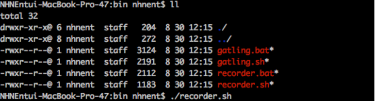
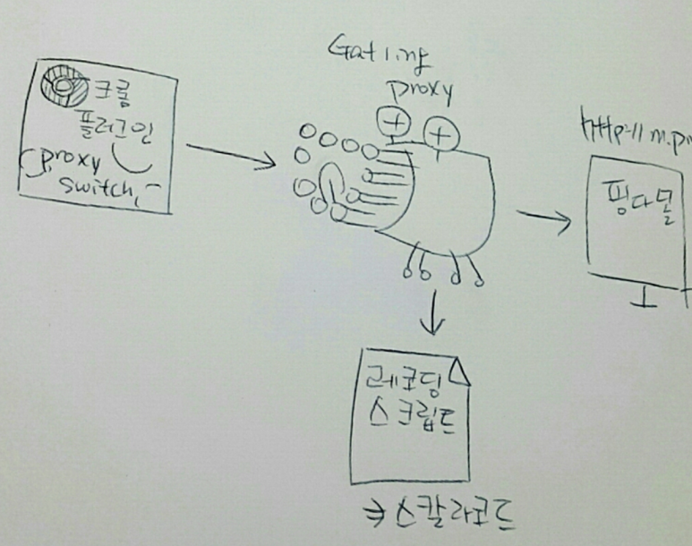
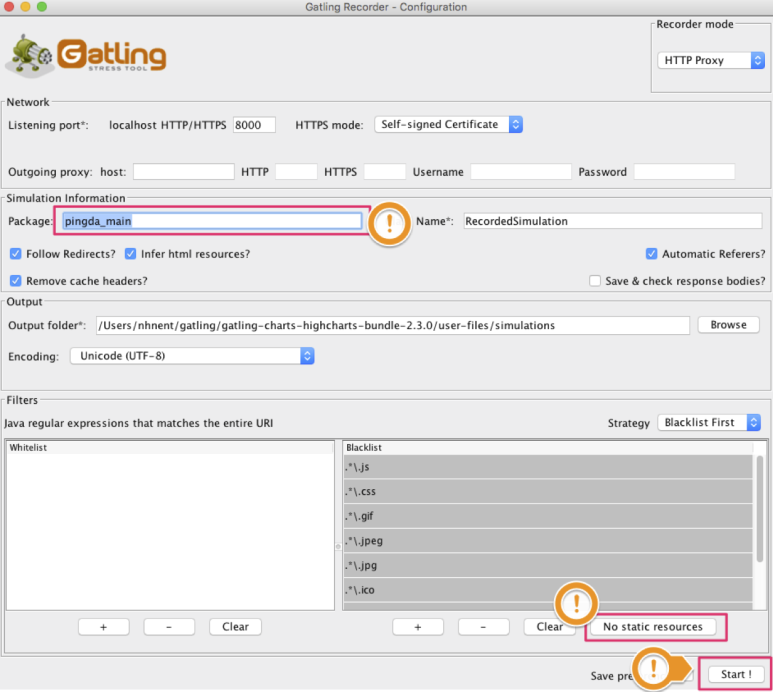
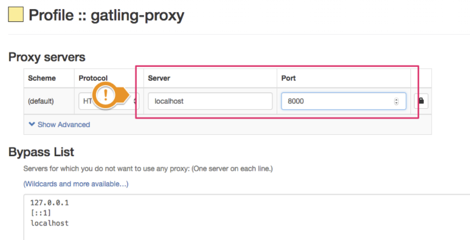
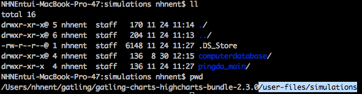
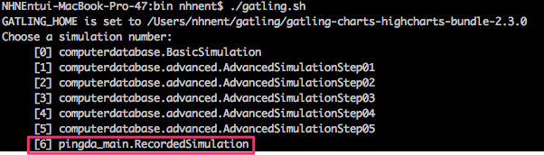
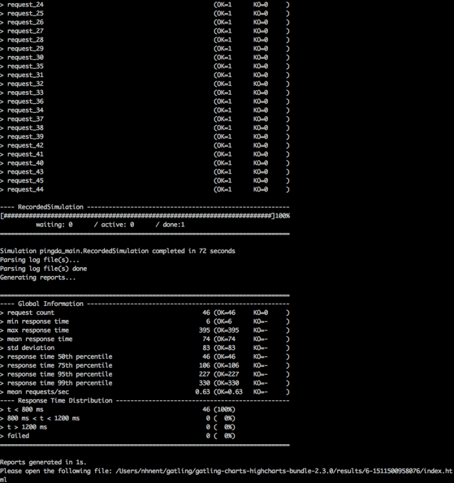
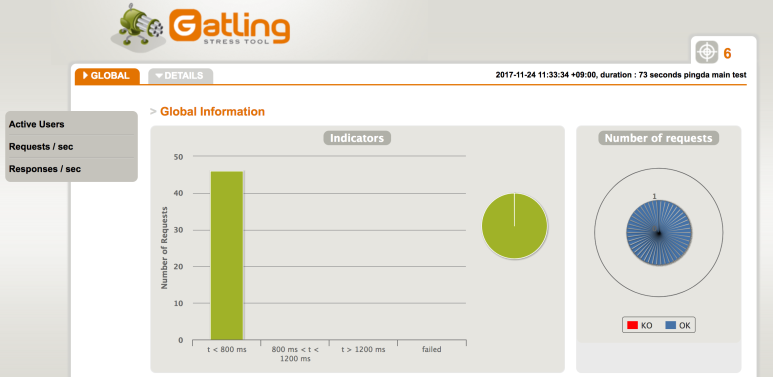

#### Gatling에 대하여…

지금까지는 금수저로 살아서 성능테스트는 로드런너 밖에 안써봤어요..
내가 만든 프로그램이 얼마나 잘 버틸까 궁금하잖아요?
내가 아는 공짜 툴은 JMeter 밖에 없었는데 뭐 이것저것 많이 있네요..
작년에는 grinder를 좀 쓰게 좋게 만든 nGrinder로 했었대요
그러다가 혜규샘이[http://whatsup.nhnent.com/ne/board/viewByMeta/468/154980](http://whatsup.nhnent.com/ne/board/viewByMeta/468/154980#null)[#null](/PostListByTagName.nhn?blogId=rarelhw&encodedTagName=null)이런걸 알려줬어요.
이름부터 겁나 멋지네여 게를링이라니!!!
다른거 다 필요 없고 이름이 짱 멋지니까 알아보기로 해요..

게를링은 완전 심플해요

뭘 쏠지 정하고 ([recorder.sh](http://recorder.sh/))

쏘면 됩니다. ([gatling.sh](http://gatling.sh/))

세상 심플..
설치하면 실행파일이 딱 두개밖에 없어여

#### 시나리오 따기

레코딩도 따는 것도 제공해줘요!
방식은 recorder.sh를 실행시키면 얘가 프록시 서버를 8000 번 포트로 띄우고 브라우저에서 프록시 통해서 http 리퀘스트 보내면 그걸 레코딩 하는 방식이에요

./recorder.sh 실행
package는 이거 별로 시나리오 파일을 별도로 떨궈서 꼭 쓰는게 좋아요
No Static Resources 선택하면 static한 애들은 빼고 스크립트 딸 수 있어요
start! 누르면 프록시 서버가 떠요

로컬 네트워크 설정에서 프록시를 설정해도 되지만 우리는 브라우저만 프록시를 태워도 돼요.
브라우저 요청만 스크립트로 딸꺼니까여
Proxy SwitchyOmega라는 플러그인을 설치해요

New profile… 을 누르고

profile이름 정해주고 proxy profile을 새로 만들어요
프록시 서버는 로컬호스트로 하고 개를링 레코딩서버의 프록시 포트를 써줘요

그리고 알파 핑다에 들어가서 이런 저런 작업을 해주면 스크립트가 뙇 떨어집니다.
/user-files/simulations 요기에 패키지 별로 생깁니다.

스크립트는 아래처럼 스칼라 코드로 나오는데요 그냥 줄줄 읽기 나쁘지 않아요..
수정하는 방법은 더 연구해 볼께요..
(중략) val scn = scenario("RecordedSimulation") .exec(http("request_0") .get(uri1 + "/") .headers(headers_0)) .pause(1) .exec(http("request_1") .options("/display/sections/3") .headers(headers_1) .resources(http("request_2") .options("/categories") .headers(headers_1), http("request_3") .options("/products/search?order.by=POPULAR&order.direction=DESC&pageNumber=1&pageSize=20&hasTotalCount=true") .headers(headers_1), http("request_4") (후략)

#### 이제 쏴볼까요?

걍 ./gatling.sh를 실행하면 어떤 시나리오를 실행해볼껀지 물어보네요

[6] pingda_main.RecordedSimulation 를 선택해 보아요
그리고 시뮬레이션 ID랑 description을 한번 더 입력받고 막 쏘네요

결과를 html로 떨궈주고 nginx에 오렬서 보니까 이쁘게 나오네여

#### 해보고 싶은 것

개를링이가 진짜 가벼워서 로컬에서 막 쏴봐도 될 것 같아요.
그런데.. 그랬다가는 혹시나 회사에서 DDOS 돌리냐고 인프라팀에 잡혀갈까봐 서버에서 돌리는 게 좋을 것 같아요…

여러대 서버에서 묶어서도 돌릴 수 있대요.. 그런데 서버는 빵빵하니까 한대에서 쏴도 될 것 같아요
