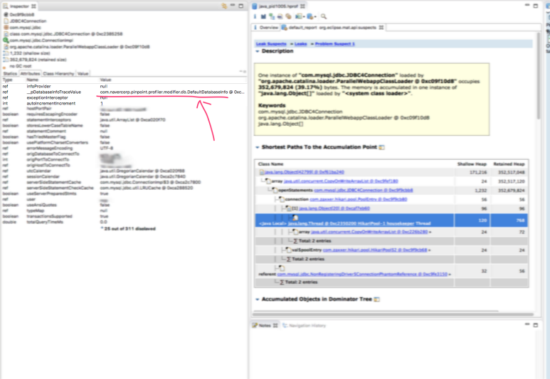
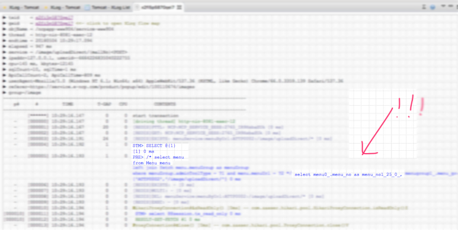

저희 서비스중에 외부연동으로 데이터를 벌크로 등록하는 서비스가 있는데요..
트랜젝션이 좀 복잡한 데이터가 분당 100개씩 2~3시간 정도 등록하면 OOM으로 서버가 죽는 현상이 있었습니다.
힙덤프 분석을 해보니 핀포인트쪽 문제로 확인 되어서

핀포인트를 제거 하니까 OOM이 사라졌습니다!!!!

그리고!! 스카우터에서 쿼리가 안나와서 계속 고생했는데요..
안나오던 스카우터 쿼리도 나오게 됐어요!!!

원인은 모르겠으나!! 제보.. 드립니다! ^ㅂ^)/

추측컨데 우리서비스가 쿼리를 때리는 양이 많아서…
핀포인트가 그 쿼리를 쓰는 속도보다 우리 쿼리가 들어오는 속도가 많아져서 OOM이 난거겠죠..
핀포인트의 어딘가 IO처리하는 쪽에서 줄서서 대기타고 있다가 그랬겠죠??
